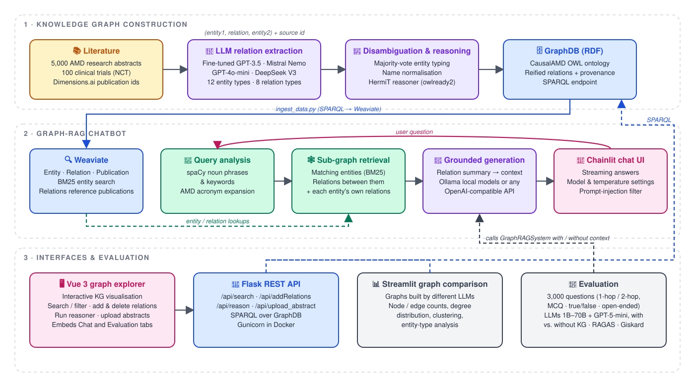
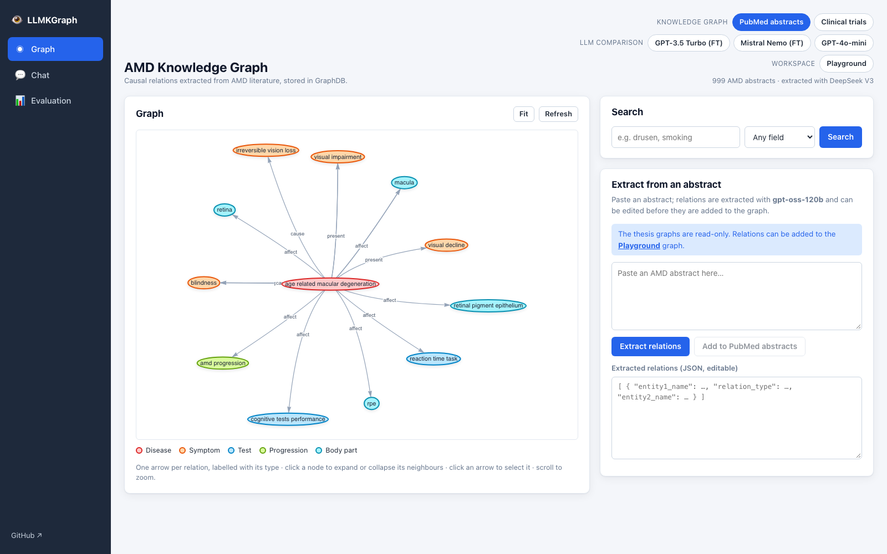

<div align="center">

# 👁️ LLMKGraph

### A Knowledge Graph-Augmented Retrieval System for Evidence-Based Age-Related Macular Degeneration Information

[](https://doi.org/10.1109/ACCESS.2025.3643370)
[](https://www.python.org/downloads/)
[](https://docs.docker.com/compose/)
[](https://github.com/AlexLecu/LLMKGraph/actions/workflows/ci.yml)

[🌐 Live Demo](https://amd-chat.ddns.net) · [🎥 Paper Overview](https://www.youtube.com/watch?v=PbS0i7zZnZk) · [🎬 Platform Demo](https://www.youtube.com/watch?v=0qlS2vuFpTo) · [📄 Paper](https://doi.org/10.1109/ACCESS.2025.3643370) · [📚 Citation](#-citation) · [🚀 Deploy](DEPLOYMENT.md)

**Official code for the paper** "[Reducing Hallucinations in Medical AI: A Knowledge Graph-Augmented Retrieval System for Evidence-Based Age-Related Macular Degeneration Information](https://doi.org/10.1109/ACCESS.2025.3643370)", *IEEE Access* **13**, 210624–210639, 2025.



*Three layers: LLM-based knowledge graph construction over AMD literature, a Graph-RAG chatbot grounded in that graph, and the web interfaces and evaluation suite built on top.*

</div>

---

## 📖 Overview

LLMKGraph turns the biomedical literature on **Age-related Macular Degeneration (AMD)** into a causal knowledge graph and uses that graph to ground a medical chatbot, so answers come with evidence instead of hallucinations. Large language models extract typed entities and relations from abstracts and clinical trials; an OWL ontology and a reasoner keep the graph consistent; a Graph-RAG retriever feeds the relevant sub-graph to the chat model at question time.

| Component | Description |
|-----------|-------------|
| 🧠 **Knowledge Graph** | Causal relations extracted from 5,000 AMD research abstracts (Dimensions.ai) and 100 clinical trials, stored in GraphDB (RDF) under the CausalAMD ontology, every relation linked to its source publication via `prov:wasDerivedFrom` |
| 🔬 **LLM Relation Extraction** | Fine-tuned GPT-3.5 Turbo and Mistral Nemo, GPT-4o-mini and DeepSeek extract 12 entity types and 8 relation types; entity disambiguation and HermiT reasoning clean the result |
| 💬 **Graph-RAG Chatbot** | Chainlit chat over Weaviate: the question is analysed with spaCy, matching entities are found with BM25, the relations between and around them are retrieved, summarised, and handed to the LLM as grounded context |

---

## 📈 Key Results

Open models from 1B to 70B parameters plus GPT-5-mini were evaluated on **3,000 questions** (1-hop and 2-hop; multiple-choice, true/false and open-ended; 500 each) with and without knowledge-graph context. Accuracy on the 1-hop sets, computed from the result files in [`backend/evaluation/`](backend/evaluation/):

| Model | True/False, KG | True/False, no KG | MCQ, KG | MCQ, no KG |
|-------|:-:|:-:|:-:|:-:|
| SmolLM3-3B | **95.6%** | 78.2% | **89.2%** | 83.8% |
| Llama 3.2-3B | **91.2%** | 80.4% | **86.4%** | 66.2% |
| Mistral-7B | **91.8%** | 90.6% | **62.8%** | 44.6% |
| Qwen3-4B | **90.6%** | 83.8% | **91.2%** | 85.4% |
| Llama 3.1-8B | **95.2%** | 93.4% | **90.0%** | 86.2% |
| Llama 3.3-70B | 97.6% | 97.8% | 94.0% | 95.0% |
| GPT-5-mini | 98.0% | 97.2% | 92.0% | 95.6% |

> Graph context gives the largest gains to small models (up to +20 points on MCQ for Llama 3.2-3B), while 70B-class and frontier models gain little because their baseline is already high. Open-ended answers are scored with RAGAS (mean faithfulness 0.85–0.97 across models and hop depths); the chatbot was also run through Giskard LLM vulnerability scans.

---

## 🧱 Components at a Glance

<div align="center"></div>

*The graph explorer: browse, search and edit causal relations, run the reasoner, and upload new abstracts for extraction.*


| Component | Description | Location |
|-----------|-------------|----------|
| 🖥️ **Web Interface** | Vue 3 app: graph visualisation (vis-network), search and filtering, relation editing, reasoner, abstract upload; embeds the Chat and Evaluation apps | [`frontend/`](frontend/) |
| 🐍 **Backend API** | Flask + Gunicorn REST API over GraphDB (search, add/delete relations, reasoning, extraction uploads) | [`backend/app.py`](backend/app.py) |
| 🔬 **Relation Extraction** | Prompted and fine-tuned LLM extractors (GPT, Mistral, DeepSeek) producing typed `(entity1, relation, entity2)` triples with provenance | [`backend/bulk_relations.py`](backend/bulk_relations.py), [`backend/prompts.py`](backend/prompts.py) |
| 🧹 **Disambiguation & Reasoning** | Majority-vote entity typing, name normalisation, and OWL reasoning with HermiT (owlready2) pushed back into GraphDB | [`backend/disambiguation/`](backend/disambiguation/) |
| 📐 **CausalAMD Ontology** | OWL ontology with 12 entity classes and the causal object properties used by the graph | [`data/CausalAMD_ont.rdf`](data/CausalAMD_ont.rdf) |
| 💬 **Graph-RAG Chatbot** | Chainlit UI, spaCy query analysis, Weaviate BM25 entity search, pairwise and per-entity relation retrieval, LLM summarisation; Ollama or any OpenAI-compatible API | [`backend/weaviate_rag/`](backend/weaviate_rag/) |
| 🔍 **Vector / Graph Store** | Weaviate `Entity`, `Relation`, `Publication` collections (text2vec-transformers), ingested from GraphDB via SPARQL | [`backend/weaviate_rag/create_schema.py`](backend/weaviate_rag/create_schema.py), [`ingest_data.py`](backend/weaviate_rag/ingest_data.py) |
| 📊 **Graph Comparison** | Streamlit app comparing graphs built by different LLMs (node/edge counts, degree distribution, clustering, entity types) | [`backend/streamlit/`](backend/streamlit/) |
| 📏 **Evaluation** | 3,000-question benchmark (Grok-generated, verified), RAGAS scoring, Giskard scans, per-model notebooks and results | [`backend/evaluation/`](backend/evaluation/) |

---

## 🚀 Quick Start

### Prerequisites
- [Docker](https://docs.docker.com/get-docker/) and Docker Compose
- An OpenAI API key (relation extraction); optional Mistral / DeepSeek / HuggingFace keys for the other extractors

### Knowledge graph + web interface

```bash
# 1. Clone
git clone https://github.com/AlexLecu/LLMKGraph.git
cd LLMKGraph

# 2. Configure (.env is git-ignored; never commit real keys)
cp .env.example .env
# edit OPENAI_API_KEY and any other provider keys you want to use

# 3. Launch GraphDB + Flask API + Streamlit + Vue frontend
docker compose up --build
```

| Service | URL |
|---------|-----|
| Vue frontend | http://localhost:8080 |
| Flask API | http://localhost:5555 |
| GraphDB Workbench | http://localhost:7200 |
| Streamlit graph comparison | http://localhost:8502 |

Then create a GraphDB repository named `amd_repo` (Workbench → Setup → Repositories) and populate it either by importing [`data/amd_repo.rdf`](data/amd_repo.rdf) (Workbench → Import) or by uploading one of the extracted relation files from [`data/Extracted_Relations/`](data/Extracted_Relations/) through the frontend's *Relation Extraction and Upload* panel.

### Graph-RAG chatbot

The chatbot has its own stack: Weaviate for retrieval and an LLM for generation (local [Ollama](https://ollama.com) by default, or any OpenAI-compatible API such as Groq, Gemini, OpenRouter or Together).

```bash
cd backend/weaviate_rag

# 1. Weaviate + text2vec-transformers
docker compose -f docker-compose-weaviate.yml up -d

# 2. Python environment (3.10–3.13)
python -m venv .venv && source .venv/bin/activate
pip install -r requirements.txt && python -m spacy download en_core_web_sm

# 3. Build the Weaviate collections from GraphDB
python create_schema.py && python ingest_data.py

# 4. Chat — http://localhost:8000
chainlit run chatbot.py -w
```

To use a hosted model instead of Ollama, set in `.env`:

```bash
CHAT_PROVIDER=openai-compatible
CHAT_API_BASE_URL=https://api.groq.com/openai/v1   # or Gemini / OpenRouter / Together
CHAT_API_KEY=...
CHAT_MODELS=llama-3.3-70b-versatile,deepseek-r1-distill-llama-70b
```

> 💡 All URLs and keys are read from environment variables; see [`.env.example`](.env.example) (backend) and [`frontend/.env.example`](frontend/.env.example) (frontend). Free hosting options for every component are in [📄 DEPLOYMENT.md](DEPLOYMENT.md).

### Manual setup (without Docker)

```bash
# Backend API (needs a running GraphDB and Java for the reasoner)
cd backend && python -m venv .venv && source .venv/bin/activate
pip install -r requirements.txt
flask run -p 5555

# Graph comparison app
streamlit run streamlit/streamlit_app_evaluation.py --server.port 8502

# Frontend — http://localhost:5173
cd ../frontend && npm install && npm run dev
```

---

## 🗂️ Project Structure

```
LLMKGraph/
├── backend/
│   ├── app.py                     # Flask REST API (search, relations, reasoning, uploads)
│   ├── prompts.py                 # Extraction + chat prompts (entity / relation vocabulary)
│   ├── bulk_relations.py          # LLM relation extraction (GPT, Mistral, DeepSeek) + bulk KG load
│   ├── enrich_kg_gpt.py           # Single-abstract extraction used by the UI
│   ├── search_kg.py               # SPARQL search / delete helpers
│   ├── disambiguation/            # Entity disambiguation + HermiT reasoning (owlready2)
│   ├── weaviate_rag/              # Graph-RAG chatbot
│   │   ├── chatbot.py             # Chainlit app (Ollama or OpenAI-compatible backends)
│   │   ├── rag_system.py          # BM25 entity retrieval, relation retrieval, LLM summary
│   │   ├── query_analyzer.py      # spaCy noun-phrase / keyword extraction
│   │   ├── create_schema.py       # Weaviate collections (Entity, Relation, Publication)
│   │   └── ingest_data.py         # GraphDB → Weaviate ETL
│   ├── streamlit/                 # Graph comparison app (+ legacy LangChain chat)
│   └── evaluation/                # Benchmark datasets, notebooks, RAGAS / Giskard results
├── frontend/                      # Vue 3 + Vite web interface
├── data/
│   ├── CausalAMD_ont.rdf          # OWL ontology
│   ├── amd_repo.rdf               # Ready-to-import GraphDB repository
│   ├── abstracts_with_id.json     # Sample of 100 abstracts (full corpus not redistributed)
│   ├── Extracted_Relations/       # Relations extracted per model and date
│   └── Annotators/                # Hand-annotated relation triples (two annotators)
├── docker-compose.yml             # GraphDB + API + Streamlit + frontend
└── DEPLOYMENT.md                  # Free hosting recipe (GitHub Pages, HF Spaces, free VM)
```

---

## 📐 Ontology and Extraction Schema

The **CausalAMD** ontology ([`data/CausalAMD_ont.rdf`](data/CausalAMD_ont.rdf)) models AMD knowledge as typed entities connected by causal and clinical relations. The extraction prompt restricts models to this vocabulary:

- 🏷️ **12 entity types** — `disease`, `symptom`, `treatment`, `risk_factor`, `test`, `gene`, `biomarker`, `complication`, `prognosis`, `comorbidity`, `progression`, `body_part`
- 🔗 **8 relation types** — `cause`, `treat`, `present`, `diagnose`, `aggravate`, `prevent`, `improve`, `affect`
- 📎 **Provenance** — every relation is a reified `ont:RELATION` node linked to its source abstract (Dimensions.ai publication id) or clinical trial (NCT number) via `prov:wasDerivedFrom`; the Weaviate `Relation` objects keep the same link through `hasPublication`
- 🔄 **Reasoning** — the graph is exported from GraphDB, classified with HermiT through owlready2, and the inferred triples are written back (*Reason KG* in the UI)

---

## 🧪 Evaluation Summary

### 📏 Benchmark
- **3,000 questions** in [`backend/evaluation/data/grok_evaluation_datasets/`](backend/evaluation/data/grok_evaluation_datasets/): 1-hop and 2-hop × multiple-choice, true/false and open-ended, 500 each; verified versions of the MCQ and true/false sets are included under `verified/`
- Each question is answered **with** and **without** the retrieved graph context, by the same model, so the effect of grounding is isolated; the notebooks call the Graph-RAG pipeline (`GraphRAGSystem`) directly

### 🤖 Models
Result files in the repo cover Gemma 3 (1B, 4B, 12B), Llama 3.2-3B, Llama 3.1-8B, Llama 3.3-70B, Mistral-7B, Mixtral-8x7B, Qwen3-4B, SmolLM3-3B and GPT-5-mini. Per-model notebooks and CSV results live in [`backend/evaluation/evaluation_notebooks/evaluation_results/`](backend/evaluation/evaluation_notebooks/evaluation_results/).

### 📊 Metrics
- Accuracy for MCQ and true/false (context impact per question is also recorded)
- **RAGAS** for open-ended answers: answer correctness, answer relevancy, faithfulness, context precision/recall
- **Giskard** LLM vulnerability scans of the chatbot (Llama 3.2, Gemma 3, DeepSeek-R1); HTML reports in [`backend/evaluation/data/giskard_scan_results/`](backend/evaluation/data/giskard_scan_results/)
- **Graph-level comparison** of KGs built by different extractors (node/edge counts, degree distribution, clustering coefficient, entity-type distribution) in the Streamlit app

---

## 📦 Data

| Resource | Description | Location |
|----------|-------------|----------|
| 📚 **Abstracts** | A 100-abstract sample with Dimensions.ai publication ids; the full 5,000-abstract corpus used in the paper is not redistributed | [`data/abstracts_with_id.json`](data/abstracts_with_id.json) |
| 🔗 **Extracted relations** | Relations per extractor and run (GPT-3.5 FT, GPT-4o-mini, Mistral FT, DeepSeek V3 on abstracts and clinical trials) | [`data/Extracted_Relations/`](data/Extracted_Relations/) |
| ✍️ **Annotations** | 67 abstracts annotated with entity spans and relations (Prodigy), relation triples from two independent annotators (163 each), and a 20-abstract evaluation set | [`data/Annotators/`](data/Annotators/), [`data/Evaluation/`](data/Evaluation/) |
| ❓ **Benchmark** | 3,000 evaluation questions with verified answers | [`backend/evaluation/data/`](backend/evaluation/data/) |
| 🗄️ **Knowledge graph** | Ready-to-import GraphDB repository + ontology | [`data/amd_repo.rdf`](data/amd_repo.rdf), [`data/CausalAMD_ont.rdf`](data/CausalAMD_ont.rdf) |

---

## 🛠️ Technologies

| Category | Stack |
|----------|-------|
| 🐍 Backend | Python, Flask, Gunicorn, SPARQLWrapper, rdflib, owlready2 + HermiT, spaCy |
| 💬 Chat / UI apps | Chainlit (Graph-RAG chatbot), Streamlit (graph comparison) |
| 🖥️ Frontend | Vue 3, TypeScript, Vite, vis-network |
| 🗄️ Databases | GraphDB 10.8 (RDF / SPARQL), Weaviate 1.28 (text2vec-transformers) |
| 🤖 LLMs | Extraction: fine-tuned GPT-3.5 Turbo and Mistral Nemo, GPT-4o-mini, DeepSeek · Chat: Ollama (Llama 3.2, DeepSeek-R1, Gemma 3) or any OpenAI-compatible API |
| 📏 Evaluation | RAGAS, Giskard, Jupyter |

---

## 📚 Citation

If you use this repository, the knowledge graph or the benchmark, please cite the paper:

```bibtex
@article{lecu2025llmkgraph,
  author  = {Lecu, Alexandru and Groza, Adrian and Hawizy, Lezan},
  title   = {Reducing Hallucinations in Medical AI: A Knowledge Graph-Augmented Retrieval
             System for Evidence-Based Age-Related Macular Degeneration Information},
  journal = {IEEE Access},
  year    = {2025},
  volume  = {13},
  pages   = {210624--210639},
  issn    = {2169-3536},
  doi     = {10.1109/ACCESS.2025.3643370},
  url     = {https://ieeexplore.ieee.org/document/11298209}
}
```

Machine-readable metadata is in [CITATION.cff](CITATION.cff).

---

## 🔒 Security & Dependencies

Dependencies are pinned with minimum versions at the patched releases flagged by GitHub security advisories; Dependabot watches the Python, npm, Docker and GitHub Actions manifests, and CI fails the frontend build on high-severity `npm audit` findings. Keep `FLASK_DEBUG=0` and set `CORS_ORIGINS` to your frontend origin before exposing the API.

## 📬 Contact

Alexandru Lecu · Technical University of Cluj-Napoca · [users.utcluj.ro/~alexlecu](https://users.utcluj.ro/~alexlecu/)
